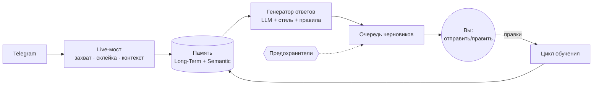

# IAM — персональный AI-агент

> **Цифровой двойник вашей переписки.** Агент снимает «нейрослепок» вашего стиля общения из архива Telegram, перенимает манеру и готовит ответы за вас — под вашим полным контролем и локально, на вашей машине.

---

## 🧠 Идея

Мы годами общаемся в мессенджерах и, по сути, оставляем там цифровой отпечаток личности: как здороваемся, когда шутим, где уточняем, а где сразу предлагаем решение. **IAM** (от *I Am* — «это я») снимает этот отпечаток с архива переписки и ставит его на службу вам.

Это не «ещё один чат-бот с промптом». Это попытка построить **объяснимую модель вашего стиля принятия решений в переписке** — и использовать её, чтобы:

- отвечать так, как ответили бы **вы**, а не «усреднённая нейросеть»;
- держать в памяти контекст по каждому собеседнику;
- со временем становиться точнее — агент учится на ваших правках.

Всё работает **локально**. Переписка, ключи доступа и сессия Telegram никуда не уходят.

---

## ✨ Что умеет

- 📥 **Импорт истории** — поднимает ваш стиль из экспортов Telegram (HTML и JSON) и из живого потока сообщений.
- 💬 **Черновики в вашей манере** — на каждое входящее готовит 2–5 вариантов ответа с разными стратегиями (коротко / уточнить / предложить решение / подробно / осторожно).
- 🧩 **Память по собеседникам** — помнит, кто есть кто, историю и контекст; релевантные куски прошлых диалогов сами подмешиваются в ответ.
- 🪞 **Метапамять о вас** — выводит объяснимые правила вашего поведения («если собеседник сообщает о поломке — предлагать решение, а не расспрашивать») и показывает их с основанием и счётчиком подтверждений.
- 📈 **Обучение на правках** — поправили черновик перед отправкой → агент это запомнил и сдвинулся в вашу сторону. Косметику (опечатки, эмодзи) не считает за сигнал, смысловые правки — считает.
- 🤖 **Полуавтомат и авто-режим** — от «черновик + ваша кнопка» до автоответа с несколькими предохранителями.
- 🔌 **Плагинная архитектура** — ядро не завязано только на Telegram: заложены точки роста в desktop/browser/IDE.

---

## 🖥 Как это выглядит

Основной режим — десктопный GUI с **очередью черновиков**: входящее приходит → агент собирает контекст и показывает варианты ответа → вы **отправляете / правите / перегенерируете / пропускаете** одной кнопкой. Если вы ответили сами с телефона — черновик снимается автоматически. Серия сообщений подряд склеивается в один ответ.

<!-- Сюда удобно добавить скриншот или GIF демонстрации очереди черновиков -->

---

## 🔧 Что внутри интересного

Короткий тур по инженерным решениям — без «секретного соуса», но чтобы было видно уровень.

- **Local-first на одном SQLite.** Вся память — в одном файле (режим WAL), в который одновременно пишут UI-поток, поток живых событий и короткоживущие воркеры. Конкурентный доступ разведён аккуратно, без гонок и блокировок.
- **Семантический recall своими силами.** Поиск по памяти — на SQLite FTS5 с bm25-ранжированием и префиксным поиском (прагматичная замена стемминга для русского). Никакого внешнего векторного хранилища — всё локально и быстро.
- **Объяснимая метапамять, а не чёрный ящик.** Правило о вашем стиле попадает в ответ только после нескольких **независимых** подтверждений и при достаточной уверенности. У каждого правила есть основание и счётчики «за/против», а ваш голос перевешивает статистику — неверное правило снимается сразу.
- **Обучение без дообучения модели.** Пары «было → стало» дрейфуют стиль ответов прямо в контексте; отдельный классификатор отделяет смысловую правку от косметической, чтобы агент учился на правильном сигнале.
- **Честная идентичность собеседников.** Один человек из разных источников (экспорт + live) сшивается **явными** связями, а не совпадением имени — чтобы в контекст не утекала переписка однофамильцев и «удалённых аккаунтов».
- **Многоуровневая безопасность.** Человек в контуре по умолчанию; для авто-режима — главный рубильник, лимиты частоты и стоп-слова (деньги, реквизиты, пароли, коды) с эскалацией на ручное подтверждение. Заблокированный ответ не теряется — уходит в очередь.
- **Корректная работа со временем.** Всё хранится в едином UTC, смещения аккуратно парсятся из экспортов — иначе перемешанная история из разных источников сортируется неверно.

---

## 🏗 Архитектура (высокий уровень)

Данные идут по короткому «боевому» пути: входящее → сбор контекста из памяти → генерация вариантов → очередь → ваше решение → цикл обучения обратно в память. Ядро оркестрации и плагины — отдельный слой для не-Telegram сценариев.

---

## 🧰 Технологии

| Слой | Чем сделано |
| --- | --- |
| Язык | Python 3.11+ |
| Telegram | Telethon (MTProto) |
| Хранилище / память | SQLite (WAL) + FTS5 (bm25) |
| LLM | любой OpenAI-совместимый эндпоинт (OpenAI / Groq / локальный) |
| GUI | Tkinter |
| Web-автоматизация | Playwright |
| Тесты | pytest |

---

## 🔐 Приватность и безопасность

- **Данные не покидают машину.** База переписки, ключи и сессия Telegram лежат локально и исключены из публикации.
- **Человек в контуре.** Базовый режим — только черновики; вы решаете, что уходит.
- **Предохранители авто-режима.** Отдельный рубильник, лимиты частоты, стоп-слова и обязательная ручная проверка для чувствительных тем.

---

## 🚀 Потенциал

Телеграм — лишь первый сценарий. Та же «модель вас» и тот же контур безопасности масштабируются дальше:

- 📨 единый ассистент переписки по всем каналам (почта, мессенджеры, площадки);
- 🧑‍💼 разгрузка рутины для фрилансеров, поддержки, продаж — быстрые ответы в личном тоне;
- 🗂 персональный «второй мозг»: память о людях, договорённостях и контексте;
- 🖱 за пределами чата — desktop/browser/IDE автоматизация через плагины;
- 🛡 автономные сценарии под явными политиками безопасности и журналом аудита.

**Дорожная карта:** импорт + анализ + черновики (готово) → автодообучение на правках (работает, точность растёт с объёмом правок) → desktop-контроль → автоматизация IDE/браузера → автономные сценарии с policy-engine.

---

## 📊 Статус

Рабочий прототип: ~9 000 строк, критичные места покрыты тестами (резолюция алиасов, FTS-поиск, разбор экспортов с часовыми поясами, предохранители авто-ответа). Основной сценарий — Telegram — работает. **Полный исходный код приватный.**

---

## 📄 Лицензия

**Проприетарно. Все права защищены.** © 2026 0d1ns0n.

Этот репозиторий — публичная **презентация** проекта. Полный код не опубликован и остаётся частной собственностью автора. Материалы (текст, схемы, описания) защищены авторским правом: их нельзя копировать, переиздавать или использовать для создания аналогичного продукта без письменного разрешения автора. Смотреть — можно, для оценки работы автора.

Подробности — в файле [LICENSE](LICENSE).

---

## 👤 Автор

**0d1ns0n** — [github.com/0d1ns0n](https://github.com/0d1ns0n)

По вопросам сотрудничества и лицензирования — через GitHub.
